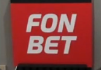
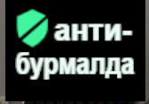
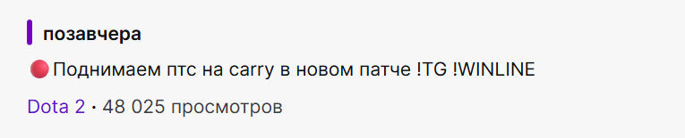

# Анти-бурмалда

Расширение для Brave, Chrome и Edge, которое скрывает рекламу букмекеров, казино и рулеток на деньги или скины. Оно ищет названия, домены, логотипы и знакомые рекламные вставки по локальному реестру. Свои правила можно добавлять прямо во время просмотра.

## Как это выглядит

**Вывеска в кадре.** Слева видна красная вывеска FONBET, справа её закрывает маска «анти-бурмалда». Оба снимка показывают один и тот же участок остановленного кадра в Brave.

| До | После |
| :---: | :---: |
|  |  |

**Команда в заголовке.** В конце названия записи команда `!WINLINE` заменяется на `анти-бурмалда` с зелёной подсветкой. Соседняя команда `!TG`, категория игры и число просмотров видны в обоих случаях.

| До | После |
| :---: | :---: |
|  |  |

## Установка в Brave

1. Скачайте [архив расширения](https://github.com/sectapunterx/anti-burmalda/releases/latest/download/anti-burmalda.zip) и распакуйте его в постоянную папку. Внутри неё должен лежать `manifest.json`.
2. Откройте `brave://extensions` и включите **Режим разработчика**.
3. Нажмите **Загрузить распакованное расширение** и выберите папку с `manifest.json`.
4. Обновите открытые вкладки. Через меню расширений откройте **Анти-бурмалда → Открыть реестр**, чтобы посмотреть правила или изменить настройки.

В **Chrome** та же страница находится по адресу `chrome://extensions`, в **Edge** — `edge://extensions`. Если вы скачали исходники через **Code → Download ZIP** или клонировали репозиторий, на третьем шаге выберите вложенную папку [extension](extension). Сборка не требуется.

**Обновление.** Распакуйте новый архив поверх файлов в прежней папке, нажмите кнопку перезагрузки на карточке расширения и обновите вкладку с видео. При обновлении в той же папке и профиле сохраняются добавленные правила.

## Первое правило

- **Текст.** Выделите название на странице, откройте контекстное меню «Анти-бурмалда» и сохраните правило. Например, в названии трансляции команда `!WINLINE` заменяется отдельно, а превью остаётся доступным.
- **Баннер.** Нажмите **Alt+Shift+B → Баннер → Выбрать область**, обведите рекламу и нажмите **Сохранить**. Так можно закрыть целый баннер на вебке, даже если картинка внутри него меняется.
- **Повторяющаяся вставка.** В том же редакторе выберите **Фрагмент**, отметьте начало и конец рекламы и сохраните образец. В роликах с перемоткой расширение сможет пропускать узнаваемые повторы. Для циклических баннеров есть отдельный режим **Анимация**.

На YouTube расширение может произнести «бурмалдá», когда известны границы конкретного упоминания. При разметке только по репликам сохраняется исходный звук. Видимыми субтитрами управляет кнопка **CC** плеера.

## Данные и ограничения

Реестр и образцы хранятся в профиле браузера. Распознавание текста в кадре выполняется на устройстве. Для фильтрации страниц расширению нужен доступ к сайтам. Качество совпадения зависит от размера, контраста и дизайна рекламы. Некоторые плееры ограничивают доступ к кадрам.

[Подробное руководство по правилам и настройкам](docs/guide.md) · [Стартовая база](extension/catalog.js) · [Сведения о компонентах OCR](extension/ocr/NOTICE.txt)
