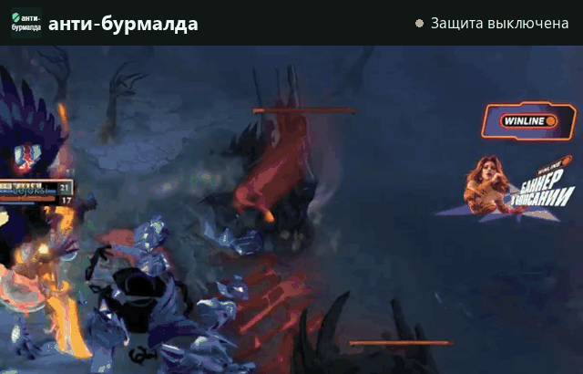
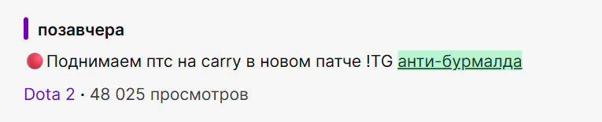

# Анти-бурмалда

Анти-бурмалда скрывает рекламу и упоминания букмекеров, казино и рулеток на деньги или скины в Brave, Chrome и Edge. В статье расширение заменяет название букмекера, в описании канала закрывает рекламный баннер, а в видео ищет знакомую вывеску или вставку. Стартовая база работает сразу после установки. Свои названия и образцы можно добавлять прямо на открытой странице.

[Скачать текущую версию](https://github.com/sectapunterx/anti-burmalda/archive/refs/heads/main.zip) · [Инструкция по установке](#установка) · [Подробное руководство](docs/guide.md)

## Что вы увидите на разных сайтах

| Где | Как работает расширение |
| --- | --- |
| Статьи, форумы и комментарии | В обычном тексте совпавшее название заменяется выделенной надписью **анти-бурмалда**. Остальная часть предложения остаётся читаемой. Правило действует и на нейтральные упоминания бренда. |
| Баннеры и ссылки на сайтах | Расширение проверяет адрес ссылки, подписи, картинки и поддерживаемые фоновые изображения. Распознанный рекламный элемент закрывается маской. Загрузку встроенных ресурсов с доменов из реестра блокирует браузер. |
| Twitch и другие прямые эфиры | В доступных кадрах плеера расширение ищет знакомые логотипы, анимации и надписи. Вывеску на вебке или плашку над мини-картой закрывает прямо в кадре. При такой замене игра остаётся видимой и звук эфира продолжается. |
| Страница канала Twitch | В разделе «О канале» расширение проверяет текст описания, ссылки и графические панели. В чате и заголовках заменяет команды вроде `!WINLINE`. Если упоминание есть только в команде в названии эфира, превью остаётся видимым. |
| YouTube | Обрабатываются заголовки, описания под роликом, комментарии и открытая расшифровка. В самом ролике работают визуальные правила, пропуск знакомых вставок и голосовая замена отдельных упоминаний. |

В стартовом реестре 94 проекта, 278 вариантов названий и фраз, 101 доменное правило и 19 визуальных образцов. Для срабатывания нужен признак азартного проекта. Например, когда в одной плашке над мини-картой BetBoom сменяется магазином GGsel, маска снимается.

### Как это выглядит

На записи справа в кадре меняются два рекламных баннера. После включения защиты на их месте появляются маски.

В тексте результат выглядит иначе. В заголовке `!WINLINE` заменяется на **анти-бурмалда**, а соседняя команда `!TG` остаётся доступной.

| До | После |
| :---: | :---: |
|  |  |
|  |  |

## Установка

1. Скачайте [ZIP текущей версии](https://github.com/sectapunterx/anti-burmalda/archive/refs/heads/main.zip) и распакуйте в постоянную папку. Внутри `anti-burmalda-main` откройте папку **`extension`**. В ней лежит `manifest.json`.
2. Откройте в браузере `brave://extensions`, `chrome://extensions` или `edge://extensions` и включите **Режим разработчика**.
3. Нажмите **Загрузить распакованное расширение** и выберите именно папку **`extension`**.
4. Обновите уже открытые вкладки. Нажмите значок расширения → **Открыть реестр**, чтобы посмотреть стартовую базу и настройки.

**Если расширение уже установлено**, скопируйте содержимое новой папки `extension` поверх файлов в той папке, из которой браузер загружает расширение. На карточке «Анти-бурмалды» нажмите **↻** и обновите вкладки. В том же профиле и по прежнему пути ваши правила и настройки сохранятся.

## Как добавить своё правило

Нажмите **Alt+Shift+B** или откройте меню расширения → **Добавить правило на странице**. Редактор появится поверх вкладки. Выберите правило по тому, как выглядит реклама.

| Что встретилось | Что выбрать и сделать |
| --- | --- |
| Новое название букмекера в тексте | Выделите название мышью, нажмите правую кнопку и выберите «Анти-бурмалда». Проверьте написание и нажмите **Сохранить**. Это название будет заменяться и на других сайтах. |
| Новое зеркало казино в рекламной ссылке | Выберите **Домен** и укажите адрес рекламодателя. Правило охватывает и его поддомены. Прямой переход на сайт через адресную строку остаётся доступным. |
| Неподвижная вывеска на вебке | Выберите **Баннер → Выбрать область**, обведите вывеску и сохраните. Такой выбор закрепляет маску в указанной области этого плеера. |
| Один и тот же логотип в разных местах | Выберите **Логотип** и обведите сам знак. Расширение будет искать его в других местах кадра и при другом масштабе. |
| Одинаковый баннер с разными промокодами | Выберите **Баннер с промокодом**. Сначала обведите весь баннер, затем на остановленном снимке выделите постоянную деталь, например эмблему. При совпадении маска закроет баннер целиком, включая новый промокод. |
| Зацикленная анимация или GIF | Выберите **Анимация**. Для отдельной GIF-картинки достаточно щелчка по ней. Для анимации внутри видео обведите область, дождитесь сообщения **«Повтор подтверждён»** и сохраните правило. |
| Видеовставка, которая повторяется в разных роликах | Выберите **Фрагмент**. Для вставки поверх игры обведите только рекламу. Для вставки во весь экран нажмите **Начало фрагмента**. Перемотайте к концу, нажмите **Конец фрагмента → Сохранить**. Знакомую последовательность расширение ищет и в других видео. |

Известные интервалы пропуска отмечаются зелёным на шкале видео. При доступной перемотке расширение переходит к концу найденной вставки. В прямом эфире без перемотки оно закрывает выбранную область.

## Как работает озвучка на YouTube

Для поиска произнесённых названий расширение использует расшифровку и доступные дорожки субтитров. Когда известны границы конкретного упоминания, расширение приглушает звук на этом коротком интервале и произносит **«бурмалдá»** с ударением на последнюю «а». Если YouTube даёт время только для целой реплики или текст недоступен, сохраняется исходная звуковая дорожка.

Чтобы увидеть текстовую замену, откройте на YouTube **Показать расшифровку**. Субтитрами поверх видео управляет штатная кнопка **CC**. Озвучку можно отключить в настройках расширения.

## Настройки и данные

- **Оформление.** В реестре, в разделе **Маскирование**, можно задать свой текст замены и выбрать логотип или однотонную чёрную маску.
- **Точность.** Если часто закрываются посторонние детали игры, повысьте порог сходства логотипа. Если пропускается конкретная эмблема, добавьте её читаемый образец. Сильно сжатый кадр, прозрачный баннер или новый дизайн могут потребовать отдельного правила.
- **Доступ к видео.** Анализ идёт с интервалами, поэтому первые кадры рекламы иногда видны. Возможность читать изображение зависит от плеера и защиты видео. Системное окно «картинка в картинке» находится за пределами страницы.
- **Приватность.** Правила и образцы хранятся в профиле браузера. Сравнение кадров и распознавание русских и английских надписей выполняются на устройстве. Для обработки страниц расширению нужен доступ к сайтам.

[Руководство по правилам и настройкам](docs/guide.md) · [Стартовый каталог проектов](extension/catalog.js) · [Сведения о компонентах распознавания текста](extension/ocr/NOTICE.txt)
